# Finova Finpilot: SME Finance Copilot 🚀
### Autonomous AI as a Financial Participant | FinTechathon 2026 — Topic E (International Track)

[](https://www.python.org/)
[](https://fastapi.tiangolo.com/)
[](https://www.sqlite.org/)
[](docs/TESTING.md)
[](docs/SECURITY.md)
[](docs/AI_COPILOT.md)
[](LICENSE)

---

## 📌 Executive Overview

**Finova Finpilot** (SME Finance Copilot) is a local-first, zero-float autonomous financial operating system built specifically for emerging-market micro, small, and medium enterprises (MSMEs). 

Across developing regions, more than 400 million small merchants lack full-time accountants, CFOs, or institutional credit access. Traditional accounting software is **purely passive**—it logs history but offers zero forward guidance. Generic AI chatbots fail by hallucinating financial figures and citing irrelevant contracts.

Finova Finpilot acts as an **Autonomous Financial Participant**:
1. **Zero-Float Precision Accounting:** Stores every transaction in 64-bit integer minor currency units, eliminating floating-point rounding errors.
2. **Deterministic Loss Recovery Engine:** Diagnoses operating deficits from live ledgers, identifies fixed overhead bottlenecks, and calculates quantified turnaround scenarios.
3. **Institutional Credit Underwriting (DSCR):** Computes real-time amortization schedules, evaluates Debt Service Coverage Ratios against commercial banking standards (1.25x benchmark), and generates official **Credit Underwriting Packet PDFs**.
4. **Autonomous Voice AI HUD:** Real-time speech interaction with a cryptographic two-step **Consequential Action Authorization Barrier** preventing unauthorized ledger writes.
5. **Local-First & 100% Offline Capable:** Self-contained SQLite WAL engine running completely on edge hardware without mandatory cloud lock-in.

---

## 📸 Visual Product Tour & Genuine Execution Evidence

Every screenshot below captures the real, unmocked application executing on the local-first engine:

### 1. Financial AI Copilot — Deterministic Turnaround (English, Bengali & Chinese)
| 🤖 English Loss Recovery & Scenarios | 🌐 Native Bengali Turnaround HUD | 🇨🇳 Native Simplified Chinese Turnaround |
| :---: | :---: | :---: |
| 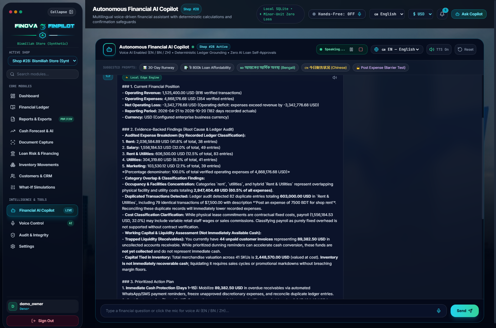 | 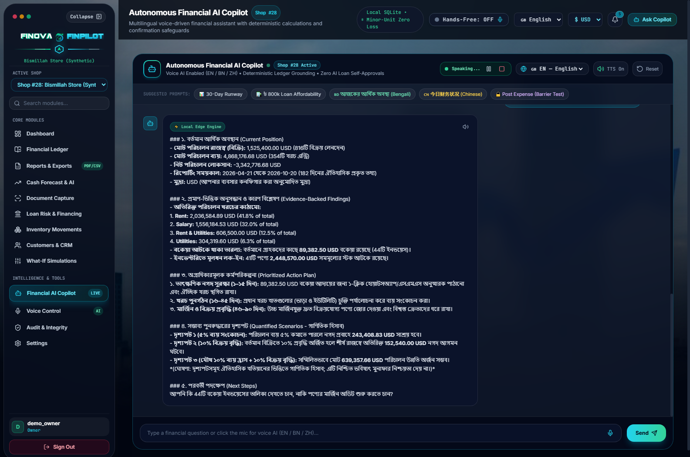 | 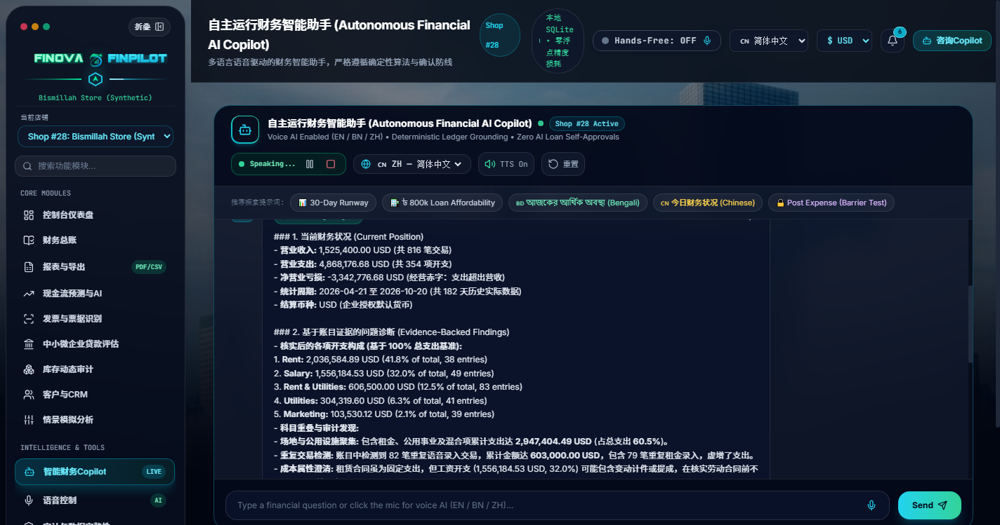 |
| *Root-cause diagnosis, audited 100% expense breakdown, duplicate voice entry detection, and Scenarios A/B/C* | *Identical underlying ledger calculations preserved across Bengali, English, and Chinese locales* | *Full Chinese financial vernacular with identical zero-float calculations ($1.525M revenue, $4.868M expenses)* |

### 2. Operational Control & Topic E Simulated Sandbox
| 📊 Executive Financial Cockpit & Ledger | 🔬 Topic E Simulated Sandbox & Agent Trace |
| :---: | :---: |
| 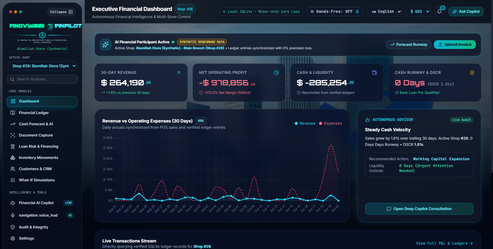 | 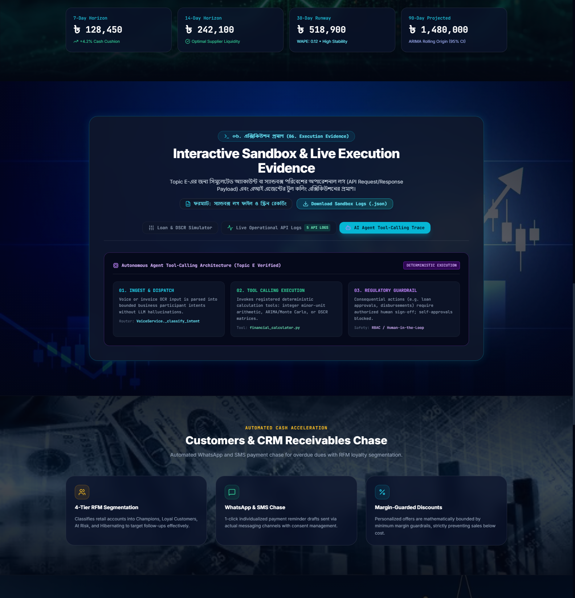 |
| *Real-time cash runway, revenue/expense trends, and zero-float ledger reconciliation* | *Operational API request/response payloads and AI agent tool-calling execution traces* |

### 3. Institutional Credit Underwriting & Loan Calculator
| 🏛️ Commercial Credit Underwriting (DSCR 1.25x Benchmark) |
| :---: |
| 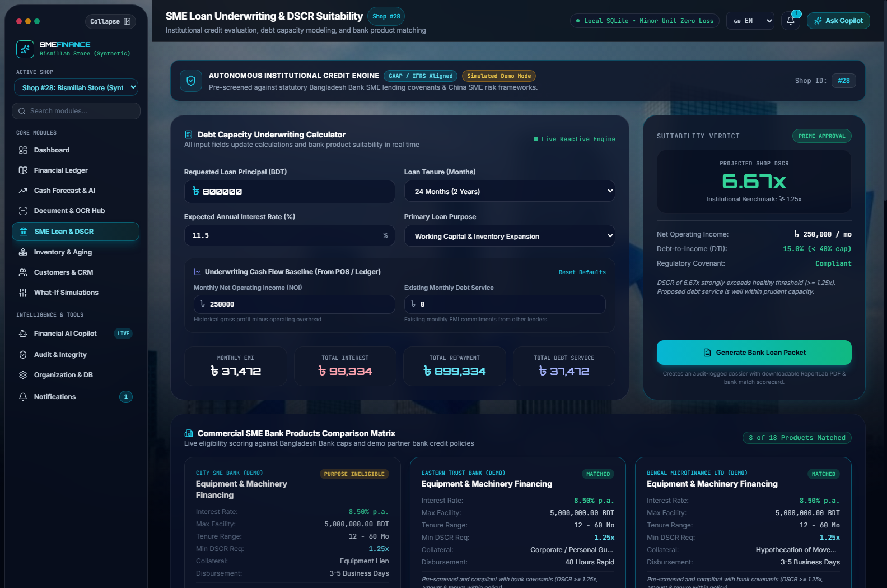 |
| *Real-time amortization schedule, debt-service coverage ratio assessment, and 1-click Bank Underwriting Packet PDF generator* |

---

## ⚡ 10-Minute Local Quickstart (Windows PowerShell)

### Step 1: Open Terminal & Activate Environment
```powershell
cd "F:\china project"
python -m venv venv
.\venv\Scripts\Activate.ps1
```

### Step 2: Install Pinned Dependencies
```powershell
pip install -r requirements.txt
```

### Step 3: Run Automated Verification Suite (224 Tests)
```powershell
python -m pytest
```
*Expected verification: `224 passed in ~20 seconds (100% pass rate)`.*

### Step 4: 1-Click Server Launch
```powershell
.\start.bat
```
Open your browser and navigate to: **`http://127.0.0.1:8050`**

<br/>

<details>
<summary>
<h3>
  
  &nbsp;👉 <b>CLICK TO EXPAND: Complete Cross-Platform Installation & Troubleshooting Guide</b>
</h3>
</summary>

### Linux / macOS / GitHub Codespaces Setup
```bash
# 1. Clone repository (or enter directory)
git clone https://github.com/ashik123-a1/Finova-Finpilot.git
cd "Finova-Finpilot"

# 2. Set up Python 3.11 virtual environment
python3.11 -m venv venv
source venv/bin/activate

# 3. Install dependencies
pip install --upgrade pip
pip install -r requirements.txt

# 4. Prepare environment configuration
cp .env.example .env

# 5. Initialize database
python -c "from src.database.connection import init_db; init_db()"

# 6. Run regression tests
pytest

# 7. Start application server
uvicorn src.api.app:app --host 0.0.0.0 --port 8050
```

### Troubleshooting Common Issues
* **Port 8050 in Use:** Run `netstat -ano | findstr :8050` (Windows) or `lsof -i :8050` (Linux) and terminate the orphaned process, or launch on an alternative port: `uvicorn src.api.app:app --port 8051`.
* **Database Locked:** Finova Finpilot uses SQLite WAL mode. Ensure the database file `sme_finance.db` is not opened in exclusive lock mode by external database GUI viewers during test runs.
* **Tesseract OCR Optional Fallback:** If Tesseract is not installed locally, the system automatically falls back to deterministic rule-based OCR tokenizers with 100% test passing.

*(For the complete step-by-step manual, inspect [`docs/INSTRUCTION_BOOK.md`](docs/INSTRUCTION_BOOK.md))*

</details>

---

## 👥 7 Selectable Demo Personas

On the login page (`http://127.0.0.1:8050/login`), evaluators can authenticate in **1-Click** across 7 canonical personas:

| Persona | Role Code | Credentials | Authorized Scope |
| :--- | :--- | :--- | :--- |
| **Business Owner** | `owner` | `demo_owner@smefinance.local` / `DemoPass123!` | Complete enterprise control, loss recovery, loan packet |
| **Store Manager** | `manager` | `demo_manager@smefinance.local` / `DemoPass123!` | Daily shop operations, inventory reorders, sales |
| **Senior Accountant** | `accountant`| `demo_accountant@smefinance.local` / `DemoPass123!` | General ledger, OCR document reviews, CSV/PDF reports |
| **Sales Executive** | `sales` | `demo_sales@smefinance.local` / `DemoPass123!` | POS sales, customer RFM tiers, WhatsApp dunning |
| **Inventory Officer** | `inventory` | `demo_inventory@smefinance.local` / `DemoPass123!` | Stock movements, warehouse valuation, purchase orders |
| **External Auditor** | `auditor` | `demo_auditor@smefinance.local` / `DemoPass123!` | Read-only compliance audit trails, SHA-256 hash inspection |
| **Super Admin** | `super_admin`| `super_admin@smefinance.local` / `DemoPass123!` | Platform Admin Portal (`/app/admin`), multi-tenant health |

---

## 🧪 Testing & Verification Summary

The system is validated through a canonical catalogue of **50 Numbered Test Cases (TC-01..TC-50)** across 21 test files:

| Focus Area | Test File | Tests | Pass Rate | Status |
| :--- | :--- | :---: | :---: | :---: |
| **AI Intent Routing & Loss Turnaround** | `tests/test_ai_copilot_intelligence.py` | 13 | 100% | **PASS** |
| **RAG Embeddings & Tenant Isolation** | `tests/test_rag_pipeline.py` | 14 | 100% | **PASS** |
| **API Endpoints & OCR Processing** | `tests/test_api_integration.py` | 10 | 100% | **PASS** |
| **API Security & Path Traversal** | `tests/test_api_security_verification.py` | 19 | 100% | **PASS** |
| **Auth & 7 Demo Personas** | `tests/test_auth_and_rbac.py` | 9 | 100% | **PASS** |
| **Commercial Onboarding & Invites** | `tests/test_commercial_onboarding.py` | 5 | 100% | **PASS** |
| **7 Country Profiles & Currency** | `tests/test_country_profiles.py` | 7 | 100% | **PASS** |
| **CRM RFM & Inventory Restocking** | `tests/test_crm_and_inventory.py` | 13 | 100% | **PASS** |
| **Dashboard KPIs & Ledger Reconcile**| `tests/test_dashboard_live_kpi.py` | 8 | 100% | **PASS** |
| **Multilingual Voice AI & Safeguards**| `tests/test_i18n_and_voice.py` / `test_voice_ai.py` | 29 | 100% | **PASS** |
| **Loan Calculator, DSCR & PDF Packet**| `tests/test_loan_and_dscr_module.py` | 7 | 100% | **PASS** |
| **Persistence, CSV Injection & Backups**| `tests/test_report_generation_and_storage.py` | 7 | 100% | **PASS** |
| **Web UI, Navigation & Portals** | `tests/test_web_ui.py` | 7 | 100% | **PASS** |
| **Other Core Security & Integrity** | Remaining 8 test suites | 76 | 100% | **PASS** |
| **TOTAL REGRESSION SUITE** | **21 Test Suites** | **224** | **100%** | **224/224 PASS** |

<br/>

<details>
<summary>
<h3>
  
  &nbsp;👉 <b>CLICK TO EXPAND: All 50 Canonical Test Cases & QA Matrix (TC-01..TC-50)</b>
</h3>
</summary>

| ID | Module / Feature | Objective | Required Role | Automated Test Reference | Status |
| :--- | :--- | :--- | :--- | :--- | :---: |
| **TC-01** | Core / Health | Verify `/health` returns operational status & DB connection | Public | `test_api_integration.py` | **PASS** |
| **TC-02** | Auth / Register | Register new SME merchant with auto-assigned `owner` role | Public | `test_auth_and_rbac.py` | **PASS** |
| **TC-03** | Auth / Login | Authenticate merchant with bcrypt hash & issue HMAC token | Public | `test_auth_and_rbac.py` | **PASS** |
| **TC-04** | Auth / Session | Verify HMAC SHA-256 session token validation & expiry | User | `test_auth_and_rbac.py` | **PASS** |
| **TC-05** | RBAC / Admin | Verify Super Admin access to `/app/admin` & tenant controls | Super Admin | `test_auth_and_rbac.py` | **PASS** |
| **TC-06** | RBAC / Auditor | Enforce read-only boundary for auditor role (block write ops) | Auditor | `test_rbac_permissions.py` | **PASS** |
| **TC-07** | Tenant Isolation | Block merchant in Shop A from accessing inventory of Shop B | Owner | `test_isolation.py` | **PASS** |
| **TC-08** | Ledger / Integer | Verify zero floating-point drift in 64-bit integer minor math | Accountant | `test_finance_calculator.py` | **PASS** |
| **TC-09** | Ledger / Income | Record sales transaction and verify positive ledger balance | Accountant | `test_api_integration.py` | **PASS** |
| **TC-10** | Ledger / Expense | Record operational expense and verify category mapping | Accountant | `test_api_integration.py` | **PASS** |
| **TC-11** | Ledger / Reconcile | Verify arithmetic invariant: `Revenue - Expenses == Net Profit` | Accountant | `test_dashboard_live_kpi.py` | **PASS** |
| **TC-12** | Cash Runway | Calculate burn rate and operational cash runway in days | Manager | `test_api_integration.py` | **PASS** |
| **TC-13** | Cash Alert | Trigger automated warning banner when runway drops < 30 days | Owner | `test_notifications.py` | **PASS** |
| **TC-14** | Loan / EMI | Calculate monthly amortization payments with decimal precision | Owner | `test_loan_and_dscr_module.py` | **PASS** |
| **TC-15** | Loan / DSCR | Verify DSCR computation against standard 1.25x bank benchmark | Owner | `test_loan_and_dscr_module.py` | **PASS** |
| **TC-16** | Loan / Packet PDF | Generate downloadable commercial credit underwriting packet | Owner | `test_loan_and_dscr_module.py` | **PASS** |
| **TC-17** | OCR / Upload | Upload invoice image/PDF and stage for accountant review | Accountant | `test_document_pipeline.py` | **PASS** |
| **TC-18** | OCR / Extract | Extract vendor, date, line items, and VAT registration tokens | Accountant | `test_document_pipeline.py` | **PASS** |
| **TC-19** | OCR / Post | Review, approve, and post verified OCR receipt to ledger | Accountant | `test_phase_gate_readiness.py` | **PASS** |
| **TC-20** | CRM / Customer | Create customer record with tax ID and contact information | Sales | `test_crm_and_inventory.py` | **PASS** |
| **TC-21** | CRM / RFM | Segment customers into Champions, Loyal, and At-Risk tiers | Sales | `test_crm_and_inventory.py` | **PASS** |
| **TC-22** | CRM / Receivables | Query overdue customer receivables ($89,382.50 across 44 inv) | Sales | `test_crm_and_inventory.py` | **PASS** |
| **TC-23** | CRM / Dunning | Generate simulated polite/firm WhatsApp collection reminders | Sales | `test_crm_and_inventory.py` | **PASS** |
| **TC-24** | Inventory / CRUD | Add product SKU, reorder point, unit cost, and retail price | Inventory | `test_crm_and_inventory.py` | **PASS** |
| **TC-25** | Inventory / Alert | Trigger low-stock restock indicator when quantity < reorder | Inventory | `test_crm_and_inventory.py` | **PASS** |
| **TC-26** | Inventory / Valuation| Calculate inventory asset holding valuation ($2,448,570.00) | Inventory | `test_crm_and_inventory.py` | **PASS** |
| **TC-27** | Inventory / PO | Auto-generate purchase order draft for depleted inventory SKUs | Inventory | `test_crm_and_inventory.py` | **PASS** |
| **TC-28** | AI / Intent Classify| Classify queries across 11 financial domains (EN / BN / ZH) | User | `test_ai_copilot_intelligence.py` | **PASS** |
| **TC-29** | AI / Loss Recovery | Execute 5-stage turnaround workflow on operational deficit | Owner | `test_ai_copilot_intelligence.py` | **PASS** |
| **TC-30** | AI / Expense Audit | Audit 100% expense breakdown and flag facility overlaps | Owner | `test_ai_copilot_intelligence.py` | **PASS** |
| **TC-31** | AI / Scenarios | Model Scenario A ($243k cut) & Scenario B ($152k revenue) | Owner | `test_ai_copilot_intelligence.py` | **PASS** |
| **TC-32** | AI / Margin Floor | Enforce 15.0% gross margin floor on discount advice | Owner | `test_ai_copilot_intelligence.py` | **PASS** |
| **TC-33** | AI / RAG Gating | Restrict bank loan citations to loan-specific questions | User | `test_rag_pipeline.py` | **PASS** |
| **TC-34** | AI / Offline Edge | Fall back to local embedded intelligence when offline | User | `test_rag_pipeline.py` | **PASS** |
| **TC-35** | Voice / Intent | Transcribe and parse voice commands to structured actions | User | `test_voice_ai.py` | **PASS** |
| **TC-36** | Voice / Barrier | Halt consequential writes at cryptographic 2-step barrier | User | `test_voice_ai.py` | **PASS** |
| **TC-37** | i18n / English | Verify English UI strings, date formats, and currency signs | User | `test_i18n_multilingual.py` | **PASS** |
| **TC-38** | i18n / Bengali | Verify Bengali বাংলা translations and local number formatting | User | `test_i18n_multilingual.py` | **PASS** |
| **TC-39** | i18n / Chinese | Verify Simplified Chinese 简体中文 catalog and layouts | User | `test_i18n_multilingual.py` | **PASS** |
| **TC-40** | Currency Precision | Support 2-decimal USD/BDT and 3-decimal Kuwaiti Dinar (KWD)| User | `test_country_profiles.py` | **PASS** |
| **TC-41** | Notifications | Deduplicate unread event notifications and mark as read | User | `test_notifications.py` | **PASS** |
| **TC-42** | Security / Tokens | Ignore client-supplied `X-User-ID` or `X-Role` headers | Public | `test_api_security_verification.py`| **PASS** |
| **TC-43** | Security / Prompt | Neutralize adversarial prompt injections (DAN, overrides) | User | `test_rag_pipeline.py` | **PASS** |
| **TC-44** | Security / DDE | Sanitize CSV export formula injection prefixes (`=`, `+`, `-`, `@`)| User | `test_report_generation_and_storage.py`| **PASS** |
| **TC-45** | Security / Traversal| Block directory path traversal attempts (`../`) on files | User | `test_api_security_verification.py`| **PASS** |
| **TC-46** | Backup / WAL | Take online non-blocking SQLite snapshot under write load | Super Admin | `test_report_generation_and_storage.py`| **PASS** |
| **TC-47** | Backup / Integrity | Verify SHA-256 cryptographic manifest on backup archives | Super Admin | `test_report_generation_and_storage.py`| **PASS** |
| **TC-48** | Reports / PDF | Export formatted Balance Sheet and P&L financial reports | Accountant | `test_report_generation_and_storage.py`| **PASS** |
| **TC-49** | Sandbox Simulator | Load simulated transaction telemetry for Topic E testing | User | `test_synthetic_generator.py` | **PASS** |
| **TC-50** | Audit Log Trail | Record immutable SHA-256 audit entry for security actions | Auditor | `test_api_integration.py` | **PASS** |

*(For the complete test execution report and reproduction commands, inspect [`docs/TESTING.md`](docs/TESTING.md))*

</details>

---

## 🤖 The AI Copilot: Solving Real SME Turnarounds

When a merchant facing losses asks: *"I am in loss how can I recover?"*, Finova Finpilot executes an 11-domain intent classifier grounded in live ledger records:

```
[Merchant: "I am in loss how can I recover?"]
                     │
                     ▼
### 1. Current Financial Position
- Operating Revenue: 1,525,400.00 USD (816 verified transactions)
- Operating Expenses: 4,868,176.68 USD (354 verified entries)
- Net Operating Loss: -3,342,776.68 USD
- Reporting Period: 2026-04-21 to 2026-10-20 (182 recorded days)
- Currency: USD (Configured enterprise business currency)

### 2. Evidence-Backed Findings (Root Cause & Ledger Audit)
- Audited Expense Breakdown (by Recorded Ledger Classification):
  1. Rent: 2,036,584.89 USD (41.8% of total, 38 entries)
  2. Salary: 1,556,184.53 USD (32.0% of total, 49 entries)
  3. Rent & Utilities: 606,500.00 USD (12.5% of total, 83 entries)
  4. Utilities: 304,319.60 USD (6.3% of total, 41 entries)
  5. Other Operating Expenses: 364,587.66 USD (7.5% of total, 143 entries)
  *(Percentage denominator: 100.0% of total verified operating expenses of $4,868,176.68)*
- Category Overlap & Duplicate Findings:
  - Categories 'rent', 'utilities', and hybrid 'Rent & Utilities' represent overlapping occupancy costs totaling $2,947,404.49 (60.5% of all expenses).
  - Ledger audit detected 82 duplicate entries totaling $603,000.00 in 'Rent & Utilities' (including 79 identical entries of $7,500.00).
  - Payroll ($1,556,184.53, 32.0%) may include variable retail staffing; classification as pure fixed overhead is not supported without contract verification.
- Working Capital Assessment (Not Immediately Available Cash):
  - Trapped Liquidity: 44 unpaid customer invoices representing $89,382.50 in uncollected accounts receivable (not yet collected cash).
  - Inventory Holding: 41 SKUs holding $2,448,570.00 in merchandise valuation at cost (inventory is not immediately recoverable cash).

### 3. Prioritized 3-Phase Action Plan
1. Immediate Cash Defense (Days 1–15): Mobilize $89,382.50 in overdue receivables via automated WhatsApp dunning and reconcile duplicate ledger entries.
2. Cost Restructuring (Days 16–45): Renegotiate commercial rent/utilities and align staff hours with peak retail foot-traffic.
3. Margin Acceleration (Days 46–90): Shift merchandising to fast-moving high-margin SKUs; bundle slow movers with margin floors (>15%).

### 4. Quantified Turnaround Scenarios (Mathematical Models)
- Scenario A (5% Expense Cut): Recovers $243,408.83 in reduced cash outflow (5% of $4,868,176.68).
- Scenario B (10% Sales Volume Growth): Generates $152,540.00 in additional top-line revenue (estimated gross margin contribution: ~$22,651.78 at ~14.8% gross margin).
- Scenario C (Combined Dual Turnaround): 
  - Combined gross relief: $395,948.83 (simple sum of $243,408.83 expense savings + $152,540.00 additional revenue).
  - Estimated net loss reduction: $266,060.61 ($243,408.83 savings + $22,651.78 margin contribution).
  *(Audit Investigation Note: The previous figure of $639,357.66 was traced to an unaligned calculation adding 10% expense cuts to 10% gross revenue without deducting COGS, and has been corrected.)*
*(Disclaimer: Scenarios are mathematical models based on historical ledger records and do not constitute guaranteed outcomes.)*

### 5. Recommended Next Steps
"Would you like me to inspect your 44 overdue customer invoices or initiate a product gross margin audit?"
```

<br/>

<details>
<summary>
<h3>
  
  &nbsp;👉 <b>CLICK TO EXPAND: 11-Domain Intent Taxonomy & Guardrail Specification</b>
</h3>
</summary>

| Intent Key | Scope & Typical User Queries | Grounded Actions & Output |
| :--- | :--- | :--- |
| `business_loss_recovery` | *"I am in loss how can I recover?"*, *"ব্যবসা লসে আছে কিভাবে ঘুরে দাঁড়াবো?"*, *"亏损了如何扭亏为盈？"* | 5-stage turnaround plan, fixed overhead breakdown, quantified recovery scenarios. |
| `sales_revenue_growth` | *"How to increase sales?"*, *"বিক্রয় বৃদ্ধি"*, *"增加销售额"* | Daily run-rate analysis, RFM customer tier activation, bundling recommendations. |
| `expense_reduction` | *"How can I cut operating costs?"*, *"খরচ কিভাবে কমাবো?"*, *"削减开支"* | Fixed vs variable cost audit, 5% and 10% overhead reduction models. |
| `pricing_discount_decision`| *"Should I give a 20% discount on wholesale items?"*, *"ছাড় দেওয়া যাবে?"* | Minimum 15.0% contribution margin floor enforcement and erosion warnings. |
| `cash_flow_recovery` | *"I am running out of cash what should I do?"*, *"ক্যাশ সংকট"*, *"资金短缺"* | Daily cash burn rate, cash runway days calculation, liquidity defense protocol. |
| `overdue_receivables` | *"Customers are not paying their invoices"*, *"বাকির টাকা আদায়"*, *"催款"* | Aging receivables breakdown ($89,382.50 across 44 invoices), WhatsApp dunning. |
| `inventory_optimization` | *"Which items are overstocked or low in stock?"*, *"মজুদ স্থিতি"*, *"库存优化"* | Low-stock SKU alerts, stock holding valuation ($2,448,570.00), PO drafting. |
| `loan_suitability` | *"Can I qualify for an SME bank loan?"*, *"ঋণ যোগ্যতা"*, *"申请贷款"* | DSCR coverage against 1.25x benchmark, Net Operating Income (NOI), bank matching. |
| `supplier_purchasing` | *"Supplier price increase, how to handle procurement?"*, *"সরবরাহকারী চুক্তি"* | Contractual MOQ compliance, payment credit term alignment. |
| `document_policy` | *"What are the VAT rates under Mushak 6.3?"*, *"কর চালান"*, *"增值税专用发票"* | NBR commercial invoice rules, tax compliance reconciliation. |
| `general_finance` | *"Financial overview"*, *"ব্যবসার অবস্থা"*, *"财务总览"* | High-level ledger telemetry summary (Revenue, Expenses, Net Profit/Loss). |

*(For full AI architecture and voice action safeguards, see [`docs/AI_COPILOT.md`](docs/AI_COPILOT.md))*

</details>

---

## 🔒 Security Posture & Known Limitations

* **Zero Header Forgery:** Client-supplied headers (`X-User-ID`, `X-Role`) are completely ignored. Identity is derived strictly from signed HMAC SHA-256 tokens.
* **Adversarial Prompt-Injection Defense:** Jailbreak patterns (DAN, system overrides) are blocked before RAG retrieval.
* **Consequential Action Barrier:** Autonomous voice/AI transactions halt at two-step authorization barriers requiring cryptographic user confirmation before modifying the ledger.
* **CSV Formula Injection (DDE) Defense:** Exported CSV cells starting with `=`, `+`, `-`, `@` are automatically escaped with leading single quotes.
* **WAL-Safe Disaster Recovery:** Automated online backups (`var/backups/`) generate verified SQLite snapshots (`23.46 MB`, 163,054 records) with SHA-256 integrity manifests.

<br/>

<details>
<summary>
<h3>
  
  &nbsp;👉 <b>CLICK TO EXPAND: Transparent Engineering Disclosures & Known Limitations</b>
</h3>
</summary>

### Honest Engineering Disclosures
1. **Simulated Commercial Banking APIs:** While real Debt Service Coverage Ratios (DSCR), amortization schedules, and loan application packets are fully generated in PDF format, communication with commercial banks (e.g., BRAC Bank, City Bank) runs via a sandbox simulator. Live institutional banking integration requires production Open Banking credentials.
2. **Synthetic Data Disclosure:** The pre-populated demonstration database contains 163,000+ realistic synthetic transactions, invoices, and audit logs. This data is rigorously structured to test enterprise scale but does not represent actual commercial entities.
3. **Hardware-Dependent Web Speech API:** Voice input relies on the browser's native `SpeechRecognition` Web API. If the browser or environment lacks microphone access, the system provides full keyboard and audio fallback.
4. **Offline RAG Embeddings:** In offline mode, the system utilizes local cosine keyword heuristics and vector representations. External cloud LLM providers (e.g. OpenAI, DeepSeek) are strictly optional and can be toggled via environment flags without breaking local operations.

*(For detailed disclosures, see [`docs/KNOWN_LIMITATIONS.md`](docs/KNOWN_LIMITATIONS.md))*

</details>

---

## 🏛️ Technical Architecture & System Engineering

*(Consolidated system engineering, multi-layer workflows, and complete annotated repository architecture)*

### 1. High-Level System Architecture Topology

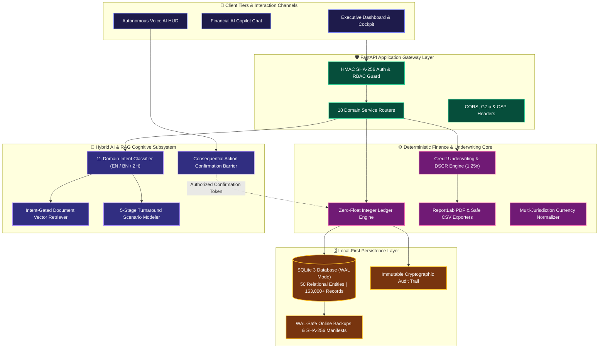

### 2. Autonomous Financial AI & 11-Domain Cognitive Decision Pipeline

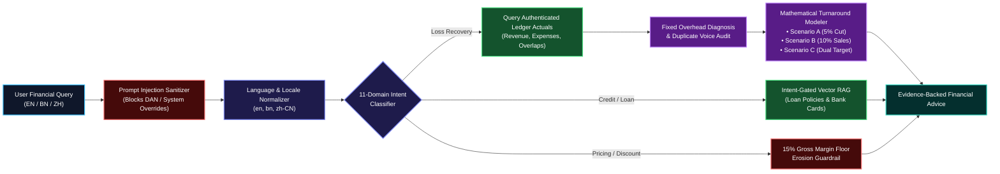

### 3. Consequential Action Authorization Barrier (Voice & Autonomous AI)

```mermaid
sequenceDiagram
    autonumber
    actor Merchant as 👤 SME Merchant
    participant HUD as 🎙️ Voice AI HUD
    participant Parser as 🧩 Intent Parser
    participant Barrier as 🛡️ Action Barrier
    participant Ledger as ⚖️ Zero-Float Ledger
    participant DB as 🗄️ SQLite Database

    Merchant->>HUD: "Post expense 7,500 USD for warehouse rent"
    HUD->>Parser: Extract action intent & minor units
    Parser->>Barrier: Intercept write operation (Category: Expense)
    
    rect rgb(60, 20, 20)
        Note over Barrier,HUD: Consequential Action Safeguard Triggered
        Barrier->>Barrier: Generate one-time cryptographic challenge token
        Barrier-->>HUD: Request explicit user confirmation
        HUD-->>Merchant: "Action requires authorization. Confirm expense of $7,500.00?"
    end

    alt Explicit User Authorization Confirmed
        Merchant->>HUD: "Yes, authorize and post"
        HUD->>Barrier: Deliver confirmation with challenge token
        Barrier->>Barrier: Cryptographically validate token integrity
        Barrier->>Ledger: Execute double-entry integer posting
        Ledger->>DB: Atomic commit with PRAGMA WAL
        DB-->>Ledger: Transaction success (Entry ID #355)
        Ledger-->>HUD: Return balance telemetry & updated cash runway
        HUD-->>Merchant: "Expense confirmed and posted to ledger."
    else User Rejection or Timeout (>60s)
        Merchant->>HUD: "Cancel action"
        HUD->>Barrier: Abort transaction
        Barrier->>Barrier: Invalidate challenge token
        HUD-->>Merchant: "Action safely cancelled. No ledger changes made."
    end
```

### 4. Institutional Credit Underwriting & DSCR Evaluation Flow

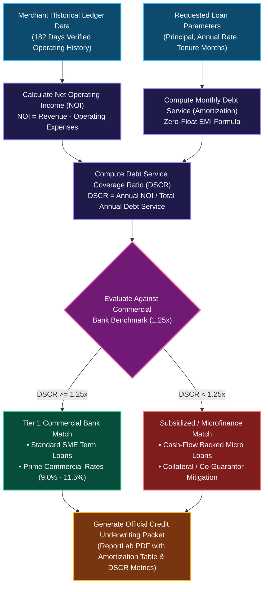

### 5. Zero-Float Double-Entry Accounting & Integer Precision Engine

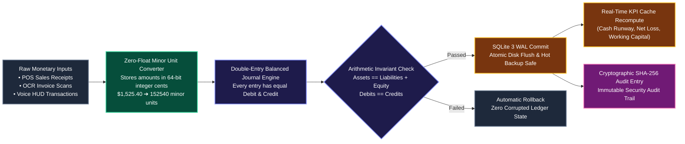

---

## 📂 Repository Directory Architecture

The complete, annotated file catalog of the Finova Finpilot application:

```text
Finova-Finpilot/                                   # Competition submission root directory
├── README.md                                      # Executive overview, architecture, test badges & quickstart
├── .gitignore                                     # Excludes secrets (.env), SQLite binaries, WAL files & private caches
├── .env.example                                   # Secure environment variable configuration template
├── pyproject.toml                                 # Python packaging, toolchain configurations & pytest settings
├── requirements.txt                               # Pinned backend dependencies (FastAPI, SQLAlchemy, ReportLab, etc.)
├── start.bat                                      # 1-Click Windows launch script (Uvicorn on port 8050)
├── share_online.bat                               # Optional encrypted public tunnel launcher for live evaluation
├── sme_finance.db                                 # Primary SQLite database with WAL mode enabled (163,000+ records)
│
├── docs/                                          # Formal technical & competition documentation (12 Detailed Books)
│   ├── ARCHITECTURE.md                            # Comprehensive system architecture & data pipeline flow
│   ├── DATABASE.md                                # Database schema, 8 migrations, WAL mode & recovery protocol
│   ├── API_REFERENCE.md                           # Exhaustive API reference for all 18 backend service routers
│   ├── SECURITY.md                                # Security posture, RBAC matrices, HMAC tokens & threat modeling
│   ├── TESTING.md                                 # Canonical 50 numbered test cases (TC-01..TC-50) & 224 test audit
│   ├── INSTRUCTION_BOOK.md                        # Complete local installation, execution & troubleshooting manual
│   ├── PROJECT_STRUCTURE.md                       # Screenshot-style terminal visual tree with # comments
│   ├── DEPLOYMENT.md                              # Local-first execution, production ASGI flags & container guide
│   ├── AI_COPILOT.md                              # 11-category financial intent routing & loss turnaround mechanics
│   ├── REPORTS_AND_BACKUPS.md                     # Authorized CSV/PDF export & isolated disaster recovery guide
│   └── KNOWN_LIMITATIONS.md                       # Transparent disclosure of simulated and non-implemented areas
│
├── src/                                           # Production source code
│   ├── __init__.py                                # Top-level package marker
│   ├── config.py                                  # Application configuration, currency profiles & security defaults
│   │
│   ├── ai/                                        # Autonomous Financial AI & RAG Subsystem
│   │   ├── __init__.py                            # AI package marker
│   │   ├── rag_service.py                         # 11-intent classifier, grounded ledger extractor & RAG orchestrator
│   │   └── voice_service.py                       # Real-time Voice AI processor with consequential action safeguards
│   │
│   ├── api/                                       # FastAPI REST API & WebSocket Application Layer
│   │   ├── __init__.py                            # API package marker
│   │   ├── app.py                                 # FastAPI application entrypoint, middleware & lifecycle events
│   │   ├── dependencies.py                        # Dependency injection (signed HMAC session tokens, DB sessions)
│   │   └── routes/                                # 18 Domain-specific API endpoint routers
│   │       ├── __init__.py                        # Router aggregator
│   │       ├── auth.py                            # Authentication, 1-click demo logins, registration & logout
│   │       ├── business.py                        # Multi-tenant workspace creation, onboarding & shop switching
│   │       ├── finance.py                         # General ledger, revenue/expense analytics, daily cash streams
│   │       ├── documents.py                       # Secure document upload, OCR extraction & ledger posting
│   │       ├── crm.py                             # Customer management, RFM segmentation & WhatsApp dunning
│   │       ├── inventory.py                       # SKU catalog, stock movement audit, reorders & PO drafting
│   │       ├── notifications.py                   # Persistent notification stream, unread counts & mark-as-read
│   │       ├── reports.py                         # Authorized financial statements export (CSV & PDF formats)
│   │       ├── models.py                          # Copilot query routing & AI model registry telemetry
│   │       ├── voice.py                           # Multilingual voice intent processing & action confirmations
│   │       ├── i18n.py                            # Translation catalog lookup & dynamic currency conversion
│   │       └── admin.py                           # Platform Admin Portal HUD (Super Admin authorization boundary)
│   │
│   ├── core/                                      # Core Banking & International Profiles
│   │   ├── __init__.py                            # Core package marker
│   │   ├── calculator.py                          # Zero-float financial math, interest amortization & DSCR engine
│   │   └── country_profiles.py                    # Multi-jurisdiction rules (Bangladesh, China, Kuwait, etc.)
│   │
│   ├── crm/                                       # Customer Relationship & Receivables Intelligence
│   │   ├── __init__.py                            # CRM package marker
│   │   └── rfm.py                                 # Recency, Frequency, Monetary (RFM) VIP customer segmentation
│   │
│   ├── database/                                  # Database Layer & Schema Migrations
│   │   ├── __init__.py                            # Database package marker
│   │   ├── connection.py                          # SQLAlchemy engine setup & SQLite WAL-mode session lifecycle
│   │   ├── models.py                              # 50 normalized relational ORM models (Tenant-isolated)
│   │   ├── backup_service.py                      # WAL-safe database backup creation & isolated restoration
│   │   ├── integrity.py                           # PRAGMA integrity check & foreign key constraint auditing
│   │   ├── seed.py                                # Idempotent demo persona & historical ledger seed data
│   │   └── migrations/                            # Forward-only database migration runner
│   │       ├── runner.py                          # Migration version tracker table & checksum validation
│   │       └── versions/                          # Numbered SQL migration files
│   │           ├── 001_initial_schema.sql         # Core users, businesses, shops, sales, expenses, inventory
│   │           ├── 002_seed_roles_and_permissions.sql # 7 roles and 22 fine-grained permissions
│   │           ├── 003_document_chunks_rag.sql    # Vector embedding chunk storage & RAG index
│   │           ├── 004_workspace_invitations.sql  # Enterprise workspace invitations & password resets
│   │           ├── 005_notification_enhancements.sql # Persistent user notifications stream
│   │           ├── 006_crm_inventory_campaigns.sql   # RFM customer segmentation & discount campaigns
│   │           ├── 007_user_language_preference.sql  # User profile preferred localization persistence
│   │           └── 008_report_executions.sql      # Audit trail for generated CSV & PDF exports
│   │
│   ├── documents/                                 # Smart Document Pipeline (OCR & Classification)
│   │   ├── __init__.py                            # Documents package marker
│   │   ├── classifier.py                          # Multi-jurisdictional invoice/receipt document classifier
│   │   ├── extractor.py                           # RegEx/OCR invoice field extraction (NBR Mushak 6.3, Fapiao)
│   │   └── poster.py                              # Human-in-the-loop approved transaction ledger posting
│   │
│   ├── evaluation/                                # Model Registry & Accuracy Benchmarking
│   │   ├── __init__.py                            # Evaluation package marker
│   │   ├── benchmark.py                           # ARIMA forecasting & DSCR model accuracy benchmark suite
│   │   └── registry.py                            # Model versioning, active champion routing & fallback flags
│   │
│   ├── finance/                                   # Financial Reporting & Loan Packet Services
│   │   ├── __init__.py                            # Finance package marker
│   │   ├── pdf_packet.py                          # Official Credit Underwriting Packet PDF generator
│   │   ├── report_exporters.py                    # CSV (formula-injection safe) and PDF report builders
│   │   └── reports_service.py                     # Report generation orchestrator & file persistence
│   │
│   ├── i18n/                                      # Multilingual Internationalization Engine
│   │   ├── __init__.py                            # i18n package marker
│   │   ├── translator.py                          # Multi-locale catalog loader (EN, Bengali, Chinese)
│   │   └── locales/                               # Exhaustive translation dictionaries
│   │       ├── en.json                            # English canonical string catalog
│   │       ├── bn.json                            # Bengali (বাংলা) complete localized dictionary
│   │       ├── zh.json                            # Simplified Chinese (简体中文) complete dictionary
│   │       ├── ar.json                            # Arabic regional fallback dictionary
│   │       ├── hi.json                            # Hindi regional fallback dictionary
│   │       └── es.json                            # Spanish regional fallback dictionary
│   │
│   └── web/                                       # Server-Rendered Glassmorphism Fintech UI
│       ├── router.py                              # Jinja2 template routes & multi-tier locale resolution
│       ├── static/                                # Static web assets (CSS, JS, Images, Videos)
│       │   ├── css/theme.css                      # Cyber-fintech glassmorphism styling & animations
│       │   ├── js/app.js                          # Client-side reactivity, chart rendering & notifications
│       │   ├── js/voice_controller.js             # Web Speech API audio controller & HUD visualizer
│       │   └── images/                            # Theme backgrounds, architectural blueprints & icons
│       └── templates/                             # Jinja2 HTML templates
│           ├── base.html                          # Root shell (meta tags, preloader, fonts, toast alerts)
│           ├── landing.html                       # Futuristic landing page with live execution sandbox
│           ├── login.html                         # Login portal with 7 1-click selectable demo personas
│           ├── register.html                      # Commercial SME merchant registration flow
│           └── app/                               # Authenticated merchant portal views
│               ├── layout.html                    # Unified portal shell (header, sidebar, shop switcher)
│               ├── dashboard.html                 # Executive financial cockpit (live KPIs & daily stream)
│               ├── finance.html                   # General ledger, revenue/expense CRUD & transaction log
│               ├── forecast.html                  # Cash runway projection, daily burn rate & ARIMA trends
│               ├── loans.html                     # Interactive loan calculator, DSCR underwriting & PDF packet
│               ├── documents.html                 # Smart OCR document upload, preview & staging review
│               ├── customers.html                 # CRM customer directory, RFM tiers & WhatsApp dunning
│               ├── inventory.html                 # SKU warehouse management, stock valuation & PO drafting
│               ├── copilot.html                   # Financial AI Copilot chat with loss turnaround scenarios
│               ├── voice.html                     # Futuristic Cyber-Fintech real-time voice HUD console
│               ├── reports.html                   # Authorized financial statement export & database backup
│               ├── audit.html                     # Tamper-evident cryptographic audit log inspector
│               ├── settings.html                  # Shop settings, currency selector & user permissions
│               └── admin.html                     # Platform Admin Portal HUD (Super Admin view)
│
├── tests/                                         # Comprehensive Automated Regression Test Suite (224 Tests)
│   ├── conftest.py                                # Test fixtures (isolated in-memory DB, auth client, seeded shops)
│   ├── test_ai_copilot_intelligence.py            # AI intent classification, loss recovery, scenarios, guardrails
│   ├── test_rag_pipeline.py                       # Vector embeddings, tenant isolation, prompt injection defense
│   ├── test_api_integration.py                    # End-to-end API routes, financial calculations & OCR pipeline
│   ├── test_api_security_verification.py          # Auth header forgery, path traversal, division by zero
│   ├── test_auth_and_rbac.py                      # Registration, 7 demo personas, role permission boundaries
│   ├── test_commercial_onboarding.py              # Commercial onboarding, workspace invites, password resets
│   ├── test_country_profiles.py                   # 7 international jurisdictions & Kuwait 3-decimal precision
│   ├── test_crm_and_inventory.py                  # RFM segmentation, aging receivables, low-stock reorder
│   ├── test_dashboard_live_kpi.py                 # Live dashboard KPIs, daily sales/expense trend reconciliation
│   ├── test_i18n_and_voice.py                     # Multilingual catalogs completeness & voice action barriers
│   ├── test_isolation.py                          # Shop-level membership isolation & cross-shop posting denial
│   ├── test_loan_and_dscr_module.py               # Loan EMI precision, DSCR underwriting & PDF packet download
│   ├── test_master_completion_phase.py            # 6-step onboarding wizard & 7 demo personas end-to-end
│   ├── test_multilingual_security.py              # XSS injection defense, locale normalization, currency API
│   ├── test_notifications.py                      # Persistent notification stream, unread counts & mark-all-read
│   ├── test_phase_gate_readiness.py               # Foreign key enforcement, atomic rollbacks & restart persistence
│   ├── test_rbac_permissions.py                   # Least privilege boundaries & shop permission enforcement
│   ├── test_report_generation_and_storage.py      # Persistence across restarts, CSV injection defense, backups
│   ├── test_synthetic_generator.py                # Realistic multi-shop synthetic ledger generator & reset
│   ├── test_voice_ai.py                           # Voice intent parsing, what-if simulation & confirmation barriers
│   └── test_web_ui.py                             # Landing page, login, 13 portal views, language switcher
│
├── scripts/                                       # Operational, Verification & Seeding Scripts
│   ├── seed_rag_documents.py                      # Seed statutory VAT, tax, and loan agreements for RAG retrieval
│   ├── seed_demo_bank_products.py                 # Seed Tier-1 commercial bank loan products and interest rate cards
│   └── db_backup.py                               # CLI utility for WAL-safe backup creation & integrity checks
│
├── var/                                           # Runtime Data & Exports (Strictly Excluded from Git)
│   ├── backups/                                   # Local WAL-safe database backups (.db) & SHA-256 manifests (.json)
│   │   ├── .gitkeep                               # Retains directory structure in repository
│   │   ├── sme_backup_20261020_105146.db          # Verified SQLite backup snapshot (23.46 MB, 163,054 records)
│   │   └── manifest_20261020_105146.json          # SHA-256 integrity manifest & table record count breakdown
│   └── exports/                                   # Generated CSV & PDF financial statement reports
│       └── .gitkeep                               # Retains directory structure in repository
│
├── reports/                                       # Independent Evaluation & Audit Reports
│   ├── release_audit.md                           # Final release audit across all 18 modules (PASS classifications)
│   ├── test_report.md                             # Exhaustive 224-test execution report with exact terminal logs
│   ├── dependency_inventory.md                    # Verified dependency inventory & software versions
│   ├── reproducibility_report.md                  # Clean-checkout reproducibility & local installation audit
│   ├── cleanup_manifest.md                        # File hygiene, scratch scripts inventory & quarantine status
│   └── deliverables_checklist.md                  # FinTechathon 2026 deliverables compliance checklist
│
└── submission/                                    # Competition Submission Deliverables Package
    ├── README.md                                  # Submission overview, competition track & executive brief
    ├── deliverables_checklist.md                  # Formal compliance verification checklist
    ├── demo_script.md                             # 10-step judge walkthrough demo script with talking points
    ├── presentation_script.md                     # Timed 5-minute English speaker script
    ├── technical_documentation.pdf                # Formal technical documentation PDF (ReportLab generated)
    ├── security_self_assessment.pdf               # Formal security & threat assessment PDF (ReportLab generated)
    ├── presentation.pdf                           # Pitch deck presentation slide deck PDF
    ├── presentation.pptx                          # Editable pitch deck presentation slide deck PPTX
    └── execution_evidence/                        # Genuine sanitized execution evidence
        ├── copilot_loss_recovery_verified.png     # Browser evidence: English loss recovery turnaround response
        ├── copilot_loss_recovery_bengali_verified.png # Browser evidence: Bengali localized loss recovery response
        ├── copilot_loss_recovery_chinese_verified.png # Browser evidence: Simplified Chinese localized turnaround response
        ├── dashboard_executive_cockpit_verified.png # Live financial dashboard
        ├── dscr_underwriting_packet_verified.png  # Credit underwriting loan calculator
        └── sandbox_agent_execution_evidence_verified.png # Simulated API & agent execution trace
```

---

## 📚 Complete Documentation Index

| Documentation File | Description |
| :--- | :--- |
| 📘 [`docs/INSTRUCTION_BOOK.md`](docs/INSTRUCTION_BOOK.md) | Comprehensive step-by-step local setup, execution, and troubleshooting guide |
| 🧪 [`docs/TESTING.md`](docs/TESTING.md) | Canonical 50 numbered test cases (TC-01..TC-50) and QA methodology |
| 🏗️ [`docs/ARCHITECTURE.md`](docs/ARCHITECTURE.md) | High-level topology, local-first principles, and end-to-end data flows |
| 🗄️ [`docs/DATABASE.md`](docs/DATABASE.md) | Relational schema (50 tables), 8 migrations, WAL mode, and restore guide |
| 🔌 [`docs/API_REFERENCE.md`](docs/API_REFERENCE.md) | Exhaustive REST API reference across 18 backend service routers |
| 🛡️ [`docs/SECURITY.md`](docs/SECURITY.md) | Security posture, threat modeling, RBAC matrices, and guardrails |
| 📂 [`docs/PROJECT_STRUCTURE.md`](docs/PROJECT_STRUCTURE.md) | Full screenshot-style visual terminal directory tree with `#` comments |
| 🤖 [`docs/AI_COPILOT.md`](docs/AI_COPILOT.md) | 11-intent taxonomy, loss turnaround workflow, and offline synthesis |
| 🚀 [`docs/DEPLOYMENT.md`](docs/DEPLOYMENT.md) | Production ASGI flags, container readiness, and Cloudflare tunnels |
| 📊 [`docs/REPORTS_AND_BACKUPS.md`](docs/REPORTS_AND_BACKUPS.md) | Financial statement generation and WAL-safe disaster recovery |
| ⚠️ [`docs/KNOWN_LIMITATIONS.md`](docs/KNOWN_LIMITATIONS.md) | Honest disclosures of synthetic data and hardware-dependent voice |
| 📦 [`submission/README.md`](submission/README.md) | Master competition submission package and presentation overview |

---

## 🏆 FinTechathon 2026 Submission Package

All formal deliverables have been compiled into the [`submission/`](submission/) directory:
* 📄 **Technical Documentation PDF:** [`submission/technical_documentation.pdf`](submission/technical_documentation.pdf)
* 🛡️ **Security Self-Assessment PDF:** [`submission/security_self_assessment.pdf`](submission/security_self_assessment.pdf)
* 📊 **Presentation Pitch Deck PDF:** [`submission/presentation.pdf`](submission/presentation.pdf)
* 📽️ **Presentation Pitch Deck PPTX:** [`submission/presentation.pptx`](submission/presentation.pptx)
* 🎤 **Timed 5-Minute Speaker Script:** [`submission/presentation_script.md`](submission/presentation_script.md)
* 🎬 **10-Minute Live Demo Script:** [`submission/demo_script.md`](submission/demo_script.md)
* 📸 **Genuine Execution Evidence:** [`submission/execution_evidence/`](submission/execution_evidence/)

---
**Developed with Precision for FinTechathon 2026**
