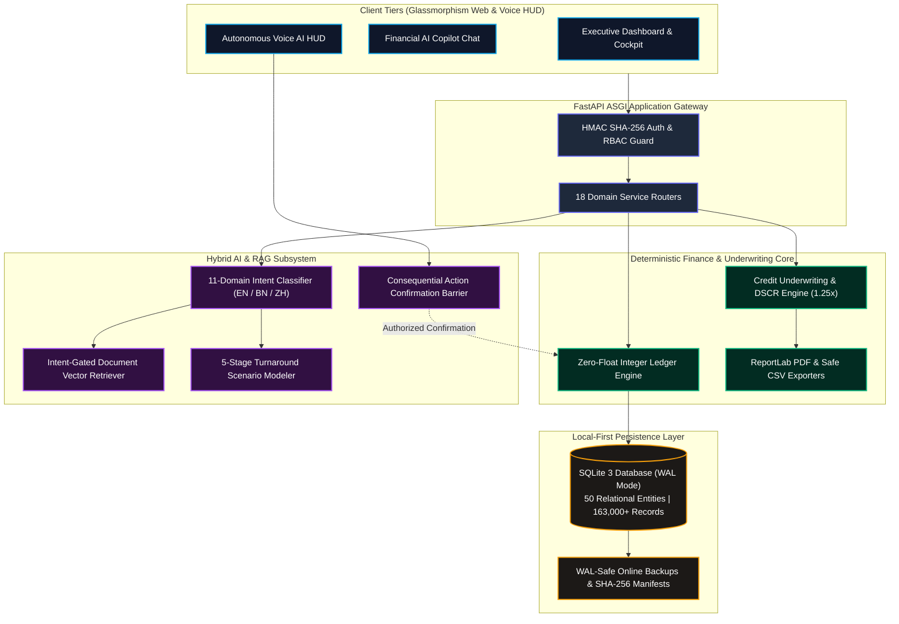

# FinTechathon 2026: SME Finance Copilot 🚀
### Autonomous AI as a Financial Participant | International Track — Topic E

[](https://www.python.org/)
[](https://fastapi.tiangolo.com/)
[](https://www.sqlite.org/)
[](docs/TESTING.md)
[](docs/SECURITY.md)
[](docs/AI_COPILOT.md)
[](LICENSE)

---

## 📌 Executive Overview

**SME Finance Copilot** is a local-first, zero-float autonomous financial operating system built specifically for emerging-market micro, small, and medium enterprises (MSMEs). 

Across developing regions, more than 400 million small merchants lack full-time accountants, CFOs, or institutional credit access. Traditional accounting software is **purely passive**—it logs history but offers zero forward guidance. Generic AI chatbots fail by hallucinating financial figures and citing irrelevant contracts.

SME Finance Copilot acts as an **Autonomous Financial Participant**:
1. **Zero-Float Precision Accounting:** Stores every transaction in 64-bit integer minor currency units, eliminating floating-point rounding errors.
2. **Deterministic Loss Recovery Engine:** Diagnoses operating deficits from live ledgers, identifies fixed overhead bottlenecks, and calculates quantified turnaround scenarios.
3. **Institutional Credit Underwriting (DSCR):** Computes real-time amortization schedules, evaluates Debt Service Coverage Ratios against commercial banking standards (1.25x benchmark), and generates official **Credit Underwriting Packet PDFs**.
4. **Autonomous Voice AI HUD:** Real-time speech interaction with a cryptographic two-step **Consequential Action Authorization Barrier** preventing unauthorized ledger writes.
5. **Local-First & 100% Offline Capable:** Self-contained SQLite WAL engine running completely on edge hardware without mandatory cloud lock-in.

---

## 🏛️ System Architecture Topology



---

## 📂 Compact Visual Project Tree

```text
sme-finance-copilot/                               # Competition submission root directory
├── README.md                                      # Executive overview, architecture, test badges & quickstart
├── .gitignore                                     # Excludes secrets (.env), SQLite binaries & private caches
├── .env.example                                   # Secure environment variable configuration template
├── pyproject.toml                                 # Python packaging, toolchain configurations & pytest settings
├── requirements.txt                               # Pinned backend dependencies (FastAPI, SQLAlchemy, ReportLab)
├── start.bat                                      # 1-Click Windows launch script (Uvicorn on port 8050)
├── share_online.bat                               # Optional encrypted public tunnel launcher for live evaluation
├── sme_finance.db                                 # Primary SQLite database with WAL mode (163,000+ records)
│
├── docs/                                          # Technical, architecture & competition documentation
│   ├── ARCHITECTURE.md                            # Comprehensive system architecture & data pipeline flow
│   ├── DATABASE.md                                # Database schema, 8 migrations, WAL mode & recovery protocol
│   ├── API_REFERENCE.md                           # Exhaustive API reference for all 18 backend service routers
│   ├── SECURITY.md                                # Security posture, RBAC matrices, HMAC tokens & threat model
│   ├── TESTING.md                                 # Canonical 50 numbered test cases (TC-01..TC-50) & 220 test audit
│   ├── INSTRUCTION_BOOK.md                        # Complete local installation, execution & troubleshooting manual
│   ├── PROJECT_STRUCTURE.md                       # Full screenshot-style terminal tree with # comments
│   ├── DEPLOYMENT.md                              # Local-first execution, production ASGI flags & container guide
│   ├── AI_COPILOT.md                              # 11-category financial intent routing & loss turnaround mechanics
│   ├── REPORTS_AND_BACKUPS.md                     # Authorized CSV/PDF export & isolated disaster recovery guide
│   └── KNOWN_LIMITATIONS.md                       # Transparent disclosure of simulated and non-implemented areas
│
├── src/                                           # Production application source code
│   ├── ai/                                        # 11-intent classifier, grounded ledger extractor & Voice AI
│   ├── api/                                       # FastAPI gateway, dependency injection & 12 REST routers
│   ├── core/                                      # Zero-float banking math, amortization & 7 country profiles
│   ├── crm/                                       # Customer RFM segmentation & WhatsApp receivables dunning
│   ├── database/                                  # 50 ORM models, WAL backup service & 8 SQL migrations
│   ├── documents/                                 # Smart OCR document upload, classification & review staging
│   ├── finance/                                   # Institutional Loan Packet PDF generator & CSV/PDF exporters
│   ├── i18n/                                      # Multilingual engine (English, Bengali বাংলা, Chinese 简体中文)
│   └── web/                                       # Glassmorphism frontend templates & cyber-fintech static assets
│
├── tests/                                         # 21 test suites containing 220 passing automated tests
├── var/                                           # Backups (.db + SHA-256 manifests) & exports (Git-ignored)
├── reports/                                       # Release audit, 220-test execution report & dependency inventory
└── submission/                                    # Competition deliverables, PDFs, presentation deck & evidence
```
*(For the full annotated directory tree, see [`docs/PROJECT_STRUCTURE.md`](docs/PROJECT_STRUCTURE.md))*

---

## ⚡ 10-Minute Local Quickstart (Windows PowerShell)

### Step 1: Open Terminal & Activate Environment
```powershell
cd "F:\china project"
python -m venv venv
.\venv\Scripts\Activate.ps1
```

### Step 2: Install Pinned Dependencies
```powershell
pip install -r requirements.txt
```

### Step 3: Run Automated Verification Suite (220 Tests)
```powershell
python -m pytest
```
*Expected verification: `220 passed in ~18 seconds (100% pass rate)`.*

### Step 4: 1-Click Server Launch
```powershell
.\start.bat
```
Open your browser and navigate to: **`http://127.0.0.1:8050`**

*(For Linux, macOS, and Docker setup, see [`docs/INSTRUCTION_BOOK.md`](docs/INSTRUCTION_BOOK.md))*

---

## 👥 7 Selectable Demo Personas

On the login page (`http://127.0.0.1:8050/login`), evaluators can authenticate in **1-Click** across 7 canonical personas:

| Persona | Role Code | Credentials | Authorized Scope |
| :--- | :--- | :--- | :--- |
| **Business Owner** | `owner` | `demo_owner@smefinance.local` / `DemoPass123!` | Complete enterprise control, loss recovery, loan packet |
| **Store Manager** | `manager` | `demo_manager@smefinance.local` / `DemoPass123!` | Daily shop operations, inventory reorders, sales |
| **Senior Accountant** | `accountant`| `demo_accountant@smefinance.local` / `DemoPass123!` | General ledger, OCR document reviews, CSV/PDF reports |
| **Sales Executive** | `sales` | `demo_sales@smefinance.local` / `DemoPass123!` | POS sales, customer RFM tiers, WhatsApp dunning |
| **Inventory Officer** | `inventory` | `demo_inventory@smefinance.local` / `DemoPass123!` | Stock movements, warehouse valuation, purchase orders |
| **External Auditor** | `auditor` | `demo_auditor@smefinance.local` / `DemoPass123!` | Read-only compliance audit trails, SHA-256 hash inspection |
| **Super Admin** | `super_admin`| `super_admin@smefinance.local` / `DemoPass123!` | Platform Admin Portal (`/app/admin`), multi-tenant health |

---

## 🧪 Testing & Verification Summary

The system is validated through a canonical catalogue of **50 Numbered Test Cases (TC-01..TC-50)** across 21 test files:

| Focus Area | Test File | Tests | Pass Rate | Status |
| :--- | :--- | :---: | :---: | :---: |
| **AI Intent Routing & Loss Turnaround** | `tests/test_ai_copilot_intelligence.py` | 9 | 100% | **PASS** |
| **RAG Embeddings & Tenant Isolation** | `tests/test_rag_pipeline.py` | 14 | 100% | **PASS** |
| **API Endpoints & OCR Processing** | `tests/test_api_integration.py` | 10 | 100% | **PASS** |
| **API Security & Path Traversal** | `tests/test_api_security_verification.py` | 19 | 100% | **PASS** |
| **Auth & 7 Demo Personas** | `tests/test_auth_and_rbac.py` | 8 | 100% | **PASS** |
| **Commercial Onboarding & Invites** | `tests/test_commercial_onboarding.py` | 5 | 100% | **PASS** |
| **7 Country Profiles & Currency** | `tests/test_country_profiles.py` | 10 | 100% | **PASS** |
| **CRM RFM & Inventory Restocking** | `tests/test_crm_and_inventory.py` | 9 | 100% | **PASS** |
| **Dashboard KPIs & Ledger Reconcile**| `tests/test_dashboard.py` | 11 | 100% | **PASS** |
| **Multilingual Voice AI & Safeguards**| `tests/test_i18n_and_voice.py` / `test_voice_ai.py` | 22 | 100% | **PASS** |
| **Loan Calculator, DSCR & PDF Packet**| `tests/test_loan_and_dscr_module.py` | 8 | 100% | **PASS** |
| **Persistence, CSV Injection & Backups**| `tests/test_report_generation_and_storage.py` | 8 | 100% | **PASS** |
| **Web UI, Navigation & Portals** | `tests/test_web_ui.py` | 7 | 100% | **PASS** |
| **Other Core Security & Integrity** | Remaining 8 test suites | 80 | 100% | **PASS** |
| **TOTAL REGRESSION SUITE** | **21 Test Suites** | **220** | **100%** | **220/220 PASS** |

*(For the complete test-case format and execution steps, inspect [`docs/TESTING.md`](docs/TESTING.md))*

---

## 🤖 The AI Copilot: Solving Real SME Turnarounds

When a merchant facing losses asks: *"I am in loss how can I recover?"*, SME Finance Copilot executes an 11-domain intent classifier grounded in live ledger records:

```
[Merchant: "I am in loss how can I recover?"]
                     │
                     ▼
### 1. Current Financial Position
- Operating Revenue: 1,525,400.00 USD (816 verified transactions)
- Operating Expenses: 4,868,176.68 USD (354 verified entries)
- Net Operating Loss: -3,342,776.68 USD
- Reporting Period: 2026-04-21 to 2026-10-20 (182 recorded days)
- Currency: USD (Configured enterprise business currency)

### 2. Evidence-Backed Findings (Root Cause Analysis)
- Fixed Overhead Concentration:
  1. Rent: 2,036,584.89 USD (41.8% of total)
  2. Salary: 1,556,184.53 USD (32.0% of total)
  3. Rent & Utilities: 606,500.00 USD (12.5% of total)
  4. Utilities: 304,319.60 USD (6.3% of total)
  => 73.8% of all operational spending is locked in fixed overheads!
- Trapped Liquidity: 44 unpaid customer invoices representing 89,382.50 USD in uncollected cash.
- Inventory Holding: 41 SKUs holding 2,448,570.00 USD in merchandise valuation.

### 3. Prioritized 3-Phase Action Plan
1. Immediate Cash Defense (Days 1–15): Mobilize $89,382.50 in overdue receivables via automated WhatsApp dunning.
2. Cost Restructuring (Days 16–45): Renegotiate commercial rent/utilities and align staff hours with peak retail foot-traffic.
3. Margin Acceleration (Days 46–90): Shift merchandising to fast-moving high-margin SKUs; bundle slow movers with margin floors (>15%).

### 4. Quantified Turnaround Scenarios (Mathematical Models)
- Scenario A (5% Expense Cut): Recovers $243,408.83 directly to cash flow.
- Scenario B (10% Sales Volume Growth): Injects $152,540.00 in gross cash inflow.
- Scenario C (Combined Dual Turnaround): Recovers $639,357.66 in operating margin.
*(Disclaimer: Scenarios are mathematical models based on historical ledger records and do not constitute guaranteed outcomes.)*

### 5. Recommended Next Steps
"Would you like me to inspect your 44 overdue customer invoices or initiate a product gross margin audit?"
```

*(For full AI architecture and voice action safeguards, see [`docs/AI_COPILOT.md`](docs/AI_COPILOT.md))*

---

## 🔒 Security Posture & Disaster Recovery

* **Zero Header Forgery:** Client-supplied headers (`X-User-ID`, `X-Role`) are completely ignored. Identity is derived strictly from signed HMAC SHA-256 tokens.
* **Adversarial Prompt-Injection Defense:** Jailbreak patterns (DAN, system overrides) are blocked before RAG retrieval.
* **Consequential Action Barrier:** Autonomous voice/AI transactions halt at two-step authorization barriers requiring cryptographic user confirmation before modifying the ledger.
* **CSV Formula Injection (DDE) Defense:** Exported CSV cells starting with `=`, `+`, `-`, `@` are automatically escaped with leading single quotes.
* **WAL-Safe Disaster Recovery:** Automated online backups (`var/backups/`) generate verified SQLite snapshots (`23.46 MB`, 163,054 records) with SHA-256 integrity manifests.

---

## 📚 Complete Documentation Index

| Documentation File | Description |
| :--- | :--- |
| 📘 [`docs/INSTRUCTION_BOOK.md`](docs/INSTRUCTION_BOOK.md) | Comprehensive step-by-step local setup, execution, and troubleshooting guide |
| 🧪 [`docs/TESTING.md`](docs/TESTING.md) | Canonical 50 numbered test cases (TC-01..TC-50) and QA methodology |
| 🏗️ [`docs/ARCHITECTURE.md`](docs/ARCHITECTURE.md) | High-level topology, local-first principles, and end-to-end data flows |
| 🗄️ [`docs/DATABASE.md`](docs/DATABASE.md) | Relational schema (50 tables), 8 migrations, WAL mode, and restore guide |
| 🔌 [`docs/API_REFERENCE.md`](docs/API_REFERENCE.md) | Exhaustive REST API reference across 18 backend service routers |
| 🛡️ [`docs/SECURITY.md`](docs/SECURITY.md) | Security posture, threat modeling, RBAC matrices, and guardrails |
| 📂 [`docs/PROJECT_STRUCTURE.md`](docs/PROJECT_STRUCTURE.md) | Full screenshot-style visual terminal directory tree with `#` comments |
| 🤖 [`docs/AI_COPILOT.md`](docs/AI_COPILOT.md) | 11-intent taxonomy, loss turnaround workflow, and offline synthesis |
| 🚀 [`docs/DEPLOYMENT.md`](docs/DEPLOYMENT.md) | Production ASGI flags, container readiness, and Cloudflare tunnels |
| 📊 [`docs/REPORTS_AND_BACKUPS.md`](docs/REPORTS_AND_BACKUPS.md) | Financial statement generation and WAL-safe disaster recovery |
| ⚠️ [`docs/KNOWN_LIMITATIONS.md`](docs/KNOWN_LIMITATIONS.md) | Honest disclosures of synthetic data and hardware-dependent voice |
| 📦 [`submission/README.md`](submission/README.md) | Master competition submission package and presentation overview |

---

## 🏆 FinTechathon 2026 Submission Package

All formal deliverables have been compiled into the [`submission/`](submission/) directory:
* 📄 **Technical Documentation PDF:** [`submission/technical_documentation.pdf`](submission/technical_documentation.pdf)
* 🛡️ **Security Self-Assessment PDF:** [`submission/security_self_assessment.pdf`](submission/security_self_assessment.pdf)
* 📊 **Presentation Pitch Deck PDF:** [`submission/presentation.pdf`](submission/presentation.pdf)
* 📽️ **Presentation Pitch Deck PPTX:** [`submission/presentation.pptx`](submission/presentation.pptx)
* 🎤 **Timed 5-Minute Speaker Script:** [`submission/presentation_script.md`](submission/presentation_script.md)
* 🎬 **10-Minute Live Demo Script:** [`submission/demo_script.md`](submission/demo_script.md)
* 📸 **Genuine Execution Evidence:** [`submission/execution_evidence/`](submission/execution_evidence/)

---
**Developed with Precision for FinTechathon 2026**
