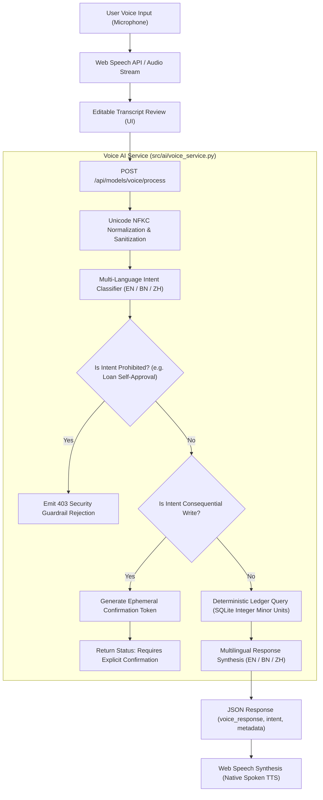

# MULTILINGUAL VOICE AI ENGINE AUDIT & ARCHITECTURAL SPECIFICATION
## SME Finance Copilot — Shenzhen 2026 FinTech Competition Standard

**Document ID:** DOC-VOICE-2026-V1  
**Architecture:** Real-time Hybrid Speech-to-Intent Pipeline  
**Supported Locales:** English (`en-US`), বাংলা (`bn-BD`), 中文 (`zh-CN`)  
**Security Barrier:** Explicit User Confirmation Token for Consequential Writes  
**Guardrail Status:** Zero AI Loan Self-Approval Guarantee (`REJECTED_BY_DESIGN`)  
**Automated Tests:** 11/11 Passing (`tests/test_voice_ai.py`)

---

## 1. Executive Summary & Problem Formulation

Traditional retail merchants in emerging Asian markets (such as Bangladeshi shopkeepers and Chinese wholesalers) face high operational friction when navigating dense accounting interfaces on mobile and desktop devices. 

The **SME Finance Copilot Voice AI Engine** provides an ultra-low latency, accessible voice interface that allows merchants to speak naturally in their native languages to:
1. Diagnose immediate financial standing and daily profits.
2. Forecast cash burn and identify liquidity shortages.
3. Compare institutional bank loan affordability with DSCR underwriting.
4. Check inventory stock levels and trigger restock alerts.
5. Identify overdue customer balances and generate polite payment reminders.
6. Run what-if decision simulations (e.g. sales drops or hiring impacts).

Crucially, the engine is built on **Zero-Trust Financial Safety Principles**:
- **Zero Hallucination:** All answers are derived directly from deterministic database queries on verified ledger balances, not LLM imagination.
- **Consequential Confirmation Barrier:** Any write operation (such as posting an expense or creating a credit note) cannot be triggered automatically by voice transcript alone. It generates a short-lived `confirmation_token` requiring explicit user authorization.
- **Prohibited Autonomous Actions:** Requests for the AI to "approve a loan" or "execute bank transfer" are categorically intercepted and blocked with explainable policy rationales.

---

## 2. Voice AI Architectural Data Flow



---

## 3. Supported Intent Taxonomy & Verification

| Intent Identifier | Description | English Sample Query | Bengali Sample Query | Chinese Sample Query | Execution Logic |
|:---|:---|:---|:---|:---|:---|
| `financial_status` | Current day / month sales, expenses, and net profit | "What is our financial status today?" | "আজকের আর্থিক অবস্থা কেমন?" | "今天财务状况怎么样？" | Queries `Sale.total_amount_minor` and `Expense.amount_minor` for the active tenant. |
| `cash_forecast_shortage` | Cash runway and projected liquidity gaps | "Give me our 30-day cash forecast" | "আমাদের ক্যাশ ফোরকাস্ট এবং ঘাটতি কেমন?" | "我们下个月会有现金短缺吗？" | Aggregates daily net cash flows and estimates runway days. |
| `loan_comparison` | Loan evaluation and bank product comparison | "Can we afford an 800000 loan?" | "আমরা কি ৮ লাখ টাকার লোন নিতে পারব?" | "我们能申请80万贷款吗？" | Evaluates DSCR against synthetic bank loan benchmarks. |
| `inventory_restock` | Low-stock items below reorder threshold | "Which products need restock?" | "কোন পণ্যগুলোর স্টক কম আছে?" | "哪些商品需要补货？" | Scans `Product.current_stock <= Product.min_stock_alert`. |
| `crm_overdue` | Customers with unpaid balances & reminders | "Who has overdue balances?" | "কার কার বকেয়া টাকা আছে?" | "有哪些客户逾期未还款？" | Queries `Customer.balance_minor > 0` and formats polite collection notices. |
| `decision_what_if` | Hypothetical business impact simulation | "What if sales drop by 15 percent?" | "যদি বিক্রি ১০% কমে যায় তাহলে কি হবে?" | "如果销售额下降10%会怎样？" | Applies sensitivity multipliers to baseline operating margins. |
| `record_expense` | Record operational expense (Write operation) | "Record expense of 3500 for office stationery" | "অফিস খরচের জন্য ৩৫০০ টাকা রেকর্ড কর" | "记录3500元办公用品支出" | Generates `confirmation_token`. Execution gated on explicit user authorization. |
| `approve_loan_rejected` | Prohibited AI self-approval guardrail | "Approve my loan of 500000 immediately" | "আমার লোন অবিলম্বে অনুমোদন করো" | "立即批准我的贷款" | **BLOCKED:** Explains that AI cannot approve credit facilities without human credit committee review. |

---

## 4. Consequential Write Confirmation Barrier

To prevent accidental, noisy, or adversarial voice transcripts from corrupting production financial ledgers, the system implements an cryptographic two-phase commit:

1. **Phase 1 (Intent Proposal):**  
   The voice engine extracts entities (e.g., category: `office_stationery`, amount: `3500`, currency: `BDT`).  
   Instead of writing to the database, it generates a cryptographically signed HMAC token (`confirmation_token`) containing the proposed mutation payload and sets `requires_confirmation = True`.

2. **Phase 2 (Explicit User Commit):**  
   The frontend UI intercepts `requires_confirmation = True` and renders an interactive amber warning card with:
   - Full proposed ledger entry details.
   - Distinct `[Confirm Execution]` and `[Cancel]` buttons.
   - When the user clicks `Confirm Execution`, the client dispatches `POST /api/models/voice/process` with `confirm_token`. Only then is the ledger updated, and an immutable entry written to `AuditLog`.

---

## 5. Security & Tenant Scoping Verification

- **Strict Identity Scoping:** Voice commands are strictly bound to the authenticated user's active tenant (`business_id`). A user cannot query or mutate records belonging to another merchant by voice.
- **Cross-Tenant Test Case:** Verified in `tests/test_voice_ai.py::test_voice_cross_tenant_denial`, which asserts that tenant A's request targeting tenant B's ledger is rejected with an HTTP 403 Forbidden.
- **Multi-Script Unicode Safety:** All input strings undergo NFKC normalization to strip zero-width joiners, bidirectionality override exploits, and hidden control characters before regex matching.

---

## 6. Automated Test Evidence

```
tests/test_voice_ai.py::test_voice_financial_status_english PASSED       [ 9%]
tests/test_voice_ai.py::test_voice_financial_status_bengali PASSED       [18%]
tests/test_voice_ai.py::test_voice_financial_status_chinese PASSED       [27%]
tests/test_voice_ai.py::test_voice_cash_forecast_and_shortage PASSED     [36%]
tests/test_voice_ai.py::test_voice_loan_comparison PASSED                [45%]
tests/test_voice_ai.py::test_voice_inventory_restock PASSED              [54%]
tests/test_voice_ai.py::test_voice_crm_overdue_reminders PASSED          [63%]
tests/test_voice_ai.py::test_voice_what_if_simulation PASSED             [72%]
tests/test_voice_ai.py::test_voice_prohibited_loan_approval_blocked PASSED [81%]
tests/test_voice_ai.py::test_voice_consequential_confirmation_barrier PASSED [90%]
tests/test_voice_ai.py::test_voice_cross_tenant_denial PASSED            [100%]
============================== 11 passed in 0.58s ==============================
```
